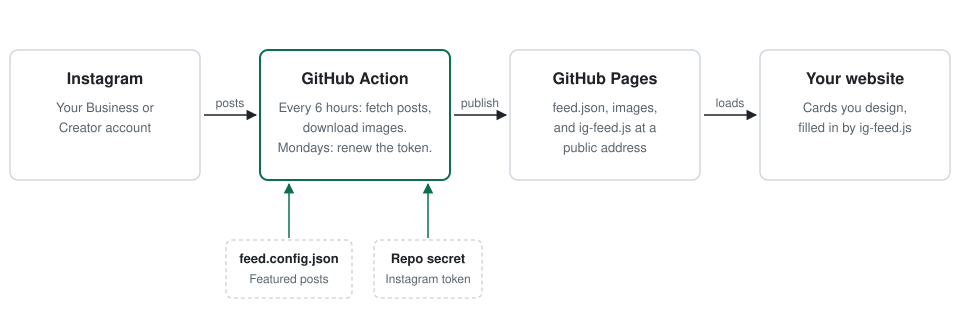

# Webflow Instagram Feed

Show your latest Instagram posts on your website, in a layout you design. Free, self-hosted on GitHub, no widget service or monthly fee. Built for Webflow, and works on any site where you can add a script tag.

[](https://github.com/yon-tyzes/webflow-instagram-feed/actions/workflows/ci.yml) [](https://github.com/yon-tyzes/webflow-instagram-feed/releases/latest) [](LICENSE) [](package.json)

<p align="center">
  <picture>
    <source media="(prefers-color-scheme: dark)" srcset="docs/assets/how-it-works-dark.svg">
    
  </picture>
</p>

**[See the live demo](https://yon-tyzes.github.io/webflow-instagram-feed/)** (sample posts).

## Why this exists

Most ways to put an Instagram feed on a website have a catch:

- Widget services charge monthly, add their branding, or limit how the feed looks.
- Embed codes ignore your site's spacing, fonts, and breakpoints.
- Older open-source scripts used Instagram's Basic Display API, which Meta shut down in December 2024.
- Instagram's image links expire, so feeds that cache them show broken images days later.

This project keeps the feed in a GitHub repository you own. You design the cards in your site builder, and the script only fills in the photos and links.

## What you get

- **Your design.** Build the cards in the Webflow Designer (or your own HTML) with your classes and breakpoints. Interactions on the cards keep working.
- **Featured posts first.** Pick up to 3 posts to lead the grid, then the latest posts fill the rest, 6 by default.
- **Images that don't break.** Photos are downloaded into the repository and served from GitHub Pages.
- **No upkeep after setup.** New posts appear within 6 hours. The Instagram token renews itself every week.
- **Accessible by default.** Each photo gets alt text (from Instagram, or the caption's first sentence), and links announce that they open Instagram in a new tab.
- **Fails quietly.** If the feed can't load, the section hides instead of showing empty boxes.
- **No dependencies.** Plain Node.js scripts and one small browser script.

## Quick start

You need a GitHub account, an Instagram Business or Creator account, and a site where you can add custom code (on Webflow, a paid site plan).

1. Click **Use this template > Create a new repository**. Make it **public** (free GitHub Pages requires it). Your token stays private either way; see [Keeping your token secret](#keeping-your-token-secret).
2. In the new repository: **Settings > Pages > Source: GitHub Actions**.
3. **Actions > Update feed > Run workflow.** Your feed is now live with sample posts at `https://YOUR-USER.github.io/YOUR-REPO/`.
4. Add the feed to your site and design it. See [Set up your website](docs/setup-website.md).
5. Get an Instagram token and save it as the repository secret `IG_ACCESS_TOKEN`. See [Set up Instagram](docs/setup-instagram.md).
6. Add a GitHub token as the secret `GH_PAT` so the Instagram token can renew itself. See [Set up GitHub](docs/setup-github.md#automatic-token-renewal).
7. Run the workflow again. Your real posts replace the samples.

Steps 3 and 4 work before you have a token, so you can design the section first.

## Use it on your site

Add one attribute to the element that holds your cards, then two snippets of custom code:

```html
<div class="your-grid" data-ig-feed="https://YOUR-USER.github.io/YOUR-REPO/feed.json">
  <a href="#"></a>
  <!-- ...as many cards as you want to show -->
</div>

<script src="https://YOUR-USER.github.io/YOUR-REPO/ig-feed.js" defer></script>
```

Each card gets a post's photo, alt text, and link, in order. On Webflow you add `data-ig-feed` under **Element settings > Custom attributes** on your grid. Optional attributes add captions, dates, and badges for featured posts or Reels. The full reference is in [Set up your website](docs/setup-website.md).

## Choose featured posts

Edit [`feed.config.json`](feed.config.json) on GitHub and paste post links in the order you want them:

```json
{
  "featured": ["https://www.instagram.com/p/ABC123xyz/"],
  "maxFeatured": 3,
  "latestCount": 3,
  "keepGridFull": true
}
```

Saving the file updates the feed. Instagram's API doesn't say which posts are pinned on your profile, so you choose featured posts here. This also lets you feature a post on your site without pinning it. Details in [Configuration](docs/configuration.md).

## Keeping your token secret

A public repository is safe for this project because the token never goes in a file.

- **The token lives in a GitHub repository secret.** Secrets are encrypted, can't be viewed after you save them, and are hidden from workflow logs.
- **Copies don't get your secrets.** Repositories created from this template, and forks, start with no secrets. Workflows triggered by pull requests from forks can't read them either.
- **The scripts never print the token.** They redact it from every message and mask a renewed token before it reaches the log.
- **What is public:** `feed.json`, the downloaded photos, captions, and your username. That's the same as your public Instagram profile shows.
- **The token can only read.** It needs one permission, `instagram_business_basic`, which reads your profile and posts. It can't post, comment, or message.

Never paste the token into `feed.config.json`, an issue, a commit, or a chat. If it leaks, cancel it and make a new one; see [Set up Instagram](docs/setup-instagram.md#if-a-token-leaks).

## Limitations

- **Pinned posts aren't detected.** List featured posts in `feed.config.json` instead.
- **Updates every 6 hours.** Run the workflow by hand for an immediate update, or change the schedule in `.github/workflows/update-feed.yml`.
- **Professional accounts only.** Instagram's API only serves Business and Creator accounts.
- **Some Reels have no image.** Reels with copyrighted music often come with no shareable thumbnail. The next post takes their place.
- **One account per repository.** For a second account, create a second repository from the template.
- **The GitHub token can expire.** If you set an expiry date on `GH_PAT`, put it on your calendar. When it lapses, the Instagram token stops renewing and the feed stops about 60 days later.

More fixes in [Troubleshooting](docs/troubleshooting.md).

## Repository layout

```text
feed.config.json               featured posts and how many to show (the file you edit)
public/                        published to GitHub Pages
  feed.json                    the feed (sample posts until a token is added)
  images/                      downloaded photos
  ig-feed.js                   the script your site loads
  index.html                   preview page
scripts/
  fetch-feed.mjs               reads posts, downloads photos, writes public/feed.json
  refresh-token.mjs            renews the Instagram token for another 60 days
  validate.mjs                 checks feed.config.json and public/feed.json
  lib.mjs                      shared helpers
.github/workflows/
  update-feed.yml              schedule, token renewal, publish to GitHub Pages
  ci.yml                       tests on every pull request
docs/                          setup guides, configuration, troubleshooting
examples/                      copy-paste snippets and a minimal HTML page
test/                          end-to-end test against a mock Instagram API
```

## Run it locally

```sh
npm run check     # syntax and configuration
npm test          # end-to-end test against a mock Instagram API
npm run preview   # preview page at http://localhost:8000
IG_ACCESS_TOKEN=your-token npm run fetch    # build the real feed on your machine
```

There are no packages to install. Node.js 20 or later is enough.

## Contributing

Issues and pull requests are welcome. Read [CONTRIBUTING.md](CONTRIBUTING.md) first.

## Security

Report problems privately, as described in [SECURITY.md](SECURITY.md).

## License

[MIT](LICENSE).

Instagram is a trademark of Meta Platforms, Inc. This project is not affiliated with or endorsed by Meta or Webflow.
